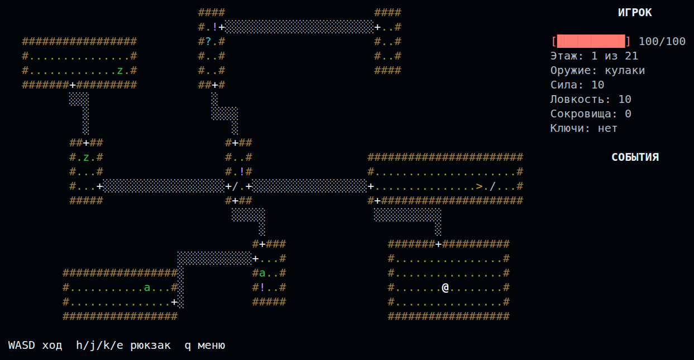
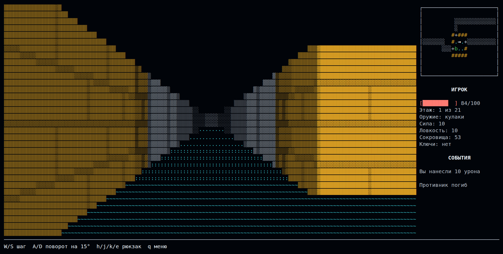

# Rogue

A console roguelike inspired by the classic *Rogue* (1980), written in pure Python with `curses`.
Explore 21 procedurally generated dungeon levels, fight monsters, collect treasure, and try to reach the bottom.
An optional first-person 3D mode renders the same dungeon with a raycaster right in the terminal.

> The in-game interface is in Russian.

## Screenshots

**Classic 2D mode** — rooms, corridors, items and enemies, with the player stats panel on the right:



**3D mode** (`--3d`) — first-person raycasted view with a mini-map:



## Features

- **21 procedurally generated levels** made of rooms and corridors, reproducible via a seed
- **Turn-based combat** with strength, agility and health stats
- **Enemies with their own AI**: zombie, vampire, ghost, ogre, snake mage and mimic
- **Inventory** of weapons, food, elixirs and scrolls
- **Fog of war**, locked doors and keys
- **Dynamic difficulty** that adapts to how well you are doing
- **Save / continue** and a **leaderboard** of runs ranked by treasure collected
- **3D mode**: first-person view with a mini-map

## Requirements

- Python 3.10+
- A terminal of at least **80×24** characters
- Linux / macOS: no extra packages needed
- Windows: `windows-curses` (installed from `requirements.txt`)

## Installation

```bash
git clone <repo-url>
cd Rogue
python3 -m venv .venv
source .venv/bin/activate        # Windows: .venv\Scripts\activate
pip install -r requirements.txt
```

## Running

The game is started from the `src` directory:

```bash
cd src
python3 main.py
```

### Command-line options

Options apply only to **New game**.

| Option          | Description                                          |
|-----------------|------------------------------------------------------|
| `--lvl N`       | Start a new game from level `N` (1–21)               |
| `--seed SEED`   | Generate levels from a fixed seed                    |
| `--smog-off`    | Disable fog of war                                   |
| `--enemy-off`   | Do not spawn enemies                                 |
| `--locks-off`   | Do not generate locked doors and keys                |
| `--balance-off` | Disable dynamic difficulty                           |
| `--3d`          | First-person 3D mode with a mini-map                 |

Example:

```bash
python3 main.py --lvl 5 --seed 42 --smog-off
```

## Controls

### Main menu

| Key       | Action        |
|-----------|---------------|
| `1`       | New game      |
| `2`       | Continue      |
| `3`       | Statistics    |
| `4` / `Q` | Quit          |

### In game (2D)

| Key               | Action                         |
|-------------------|--------------------------------|
| `W` `A` `S` `D`   | Move / attack                  |
| `H`               | Weapons (`0` unequips weapon)  |
| `J`               | Food                           |
| `K`               | Elixirs                        |
| `E`               | Scrolls                        |
| `0`–`9`           | Use the selected item          |
| `Q` / `Esc`       | Back / return to menu          |

### 3D mode

| Key                 | Action                         |
|---------------------|--------------------------------|
| `W` / `S`           | Step forward / back            |
| `A` / `D`           | Turn left / right by 15°       |
| `H` `J` `K` `E`     | Backpack, same as in 2D        |
| `Q` / `Esc`         | Return to menu                 |

## Project structure

The code follows a layered architecture: the domain knows nothing about storage or rendering
and talks to them through ports (`domain/ports.py`).

```
src/
├── main.py              # Entry point, CLI arguments
├── domain/              # Game logic, independent of UI and storage
│   ├── models/          # Character, enemies, items, levels, session, statistics
│   ├── services/        # Combat, movement, inventory, visibility, enemy AI
│   ├── generation/      # Procedural level generator
│   └── ports.py         # Repository interfaces
├── datalayer/           # JSON game data loading and save management
├── presentation/        # 2D curses UI: renderer, HUD, menu, input, controller
├── presentation3d/      # 3D first-person UI: raycaster, renderer, controller
├── data/                # Enemy, item and sprite definitions (JSON)
└── saves/               # Save file and run statistics (created at runtime)
```

## Saves

Progress is saved to `src/saves/save.json`, and finished runs are appended to
`src/saves/statistics.json`, which feeds the leaderboard. The `saves/` directory is created
automatically and is excluded from version control.

## License

[MIT](LICENSE)
